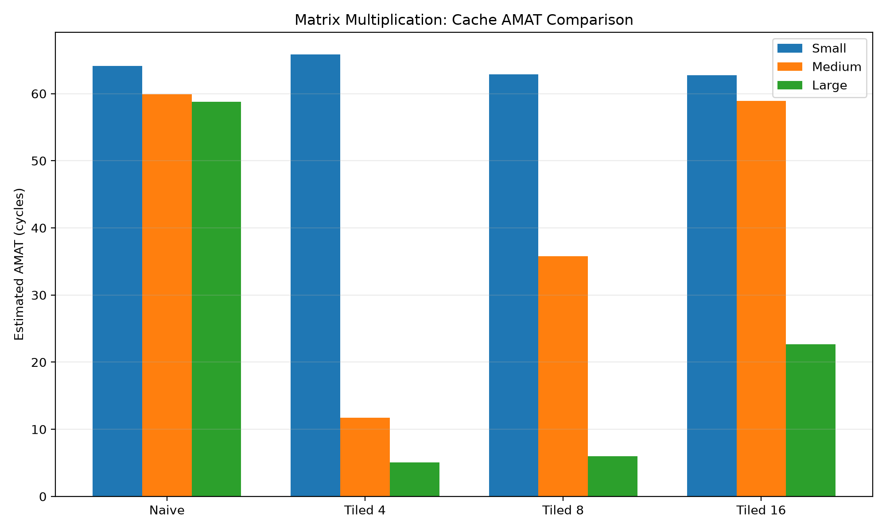
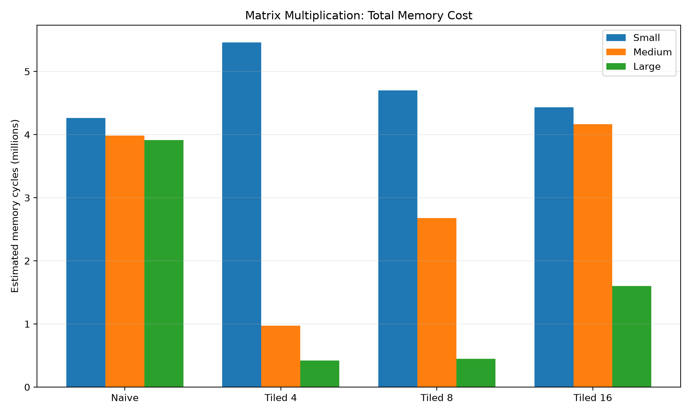
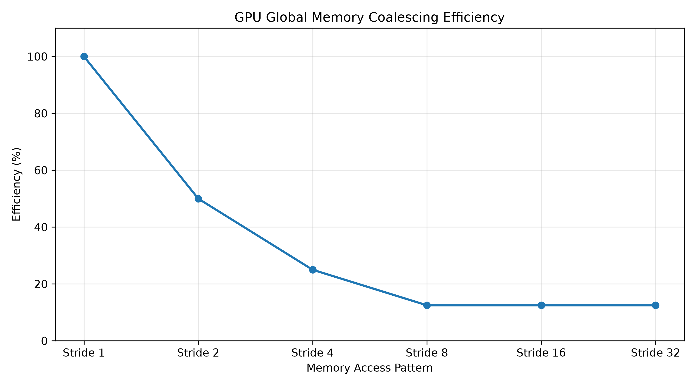
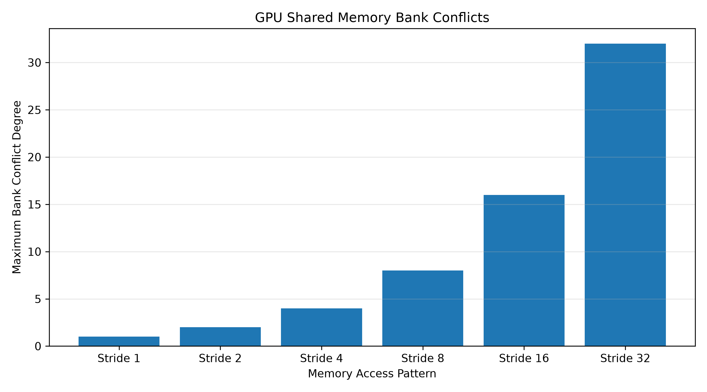
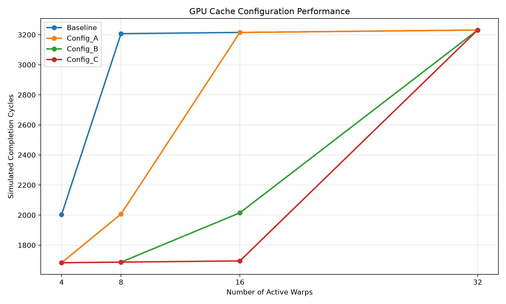
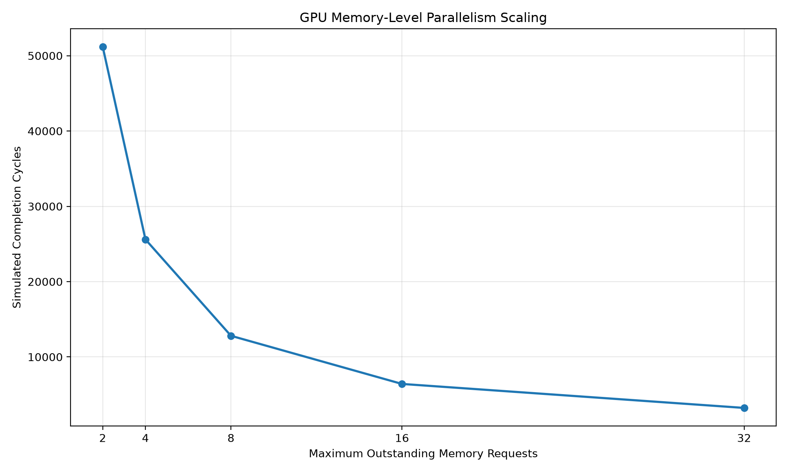
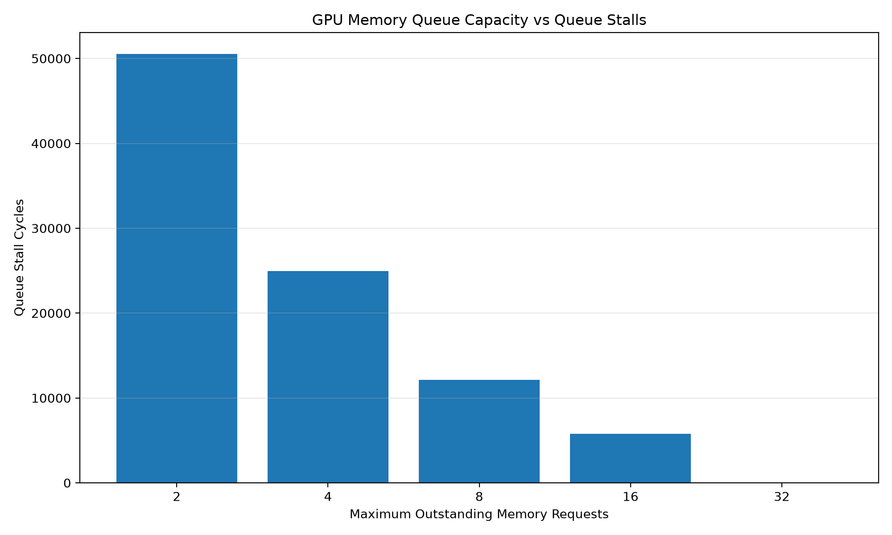

# C++ Cache Hierarchy and GPU Performance Simulator

A **C++20 trace-driven cache hierarchy and experimental GPU memory-performance simulator** for exploring memory locality, cache replacement, warp-level memory access, latency hiding, and memory-level parallelism (MLP).

The project began as a configurable inclusive L1/L2 cache simulator and was extended with GPU-inspired memory and scheduling models. It is intended for **computer architecture education and performance-modelling experiments**, not as a cycle-accurate implementation of any commercial GPU.

## Highlights

- **Two-level cache hierarchy:** configurable sets and associativity, FIFO/LRU/RANDOM replacement, write-back/write-through, dirty evictions, and inclusive L1 invalidation on L2 eviction.
- **Trace-driven experiments:** sequential, random, repeated, and strided accesses; naive and tiled matrix multiplication traces.
- **GPU memory access analysis:** 32-thread warp coalescing with 32-byte sectors, 32-bank shared-memory conflict analysis, and matrix transpose access patterns.
- **GPU scheduling:** round-robin warp scheduling, dependent instruction latencies, stall analysis, and an integrated memory-access/scheduler experiment.
- **Cache sensitivity studies:** a 16-run GPU cache configuration sweep across four cache configurations and four warp counts, exported to CSV.
- **Memory-level parallelism:** a bounded outstanding-request queue and a five-configuration MLP scaling experiment.
- **Automated verification:** 16 CTest checks, including cache sweep validation and numerical MLP regression checks (last reported passing locally).

## Architecture

The repository contains **related experimental models**, rather than one fully unified cycle-accurate pipeline:

```text
                     Trace-driven experiments
                               |
                               v
                 +---------------------------+
                 | Cache Hierarchy Simulator |
                 | L1 -> L2 -> Main Memory   |
                 +---------------------------+
                               |
                               v
                    Cache statistics / AMAT

        GPU-inspired memory and scheduling experiments

    32-lane addresses -> Coalescing / bank-conflict analysis
                              |
                              v
                     Warp memory access
                              |
                              v
                  L1/L2/DRAM latency adapter
                              |
                              v
                 Round-robin warp scheduler
                              |
                              v
                  Bottleneck and CSV reports

    Separate MLP experiment:
    Round-robin warps -> Bounded memory queue -> Timed completion
```

**Important:** The bounded memory queue is currently used by the separate MLP comparison executable; it is **not yet integrated** with the cache-aware GPU scheduler. The diagram shows related components, not a single implemented end-to-end GPU microarchitecture.

## Technology Stack

- C++20 and CMake
- GCC / MSYS2 UCRT64 on Windows
- PowerShell and CTest for automated testing
- Python 3 and Matplotlib for visualization
- Git and GitHub

## Build and Test

### Requirements

- A C++20-compatible compiler
- CMake and CTest
- Python 3 and Matplotlib (only for plots)

From the repository root:

```powershell
cmake -S . -B build
cmake --build build
ctest --test-dir build --output-on-failure
```

**Last locally reported result:** `100% tests passed out of 16`. This is a local verification result, not a claim that every future platform or configuration has been tested.

### Run selected experiments

```powershell
# GPU memory coalescing and shared-memory analysis
.\build\GPUMemoryComparison.exe

# Cache-aware integrated GPU scheduler
.\build\GPUIntegratedSimulator.exe

# GPU cache configuration sweep (writes CSV in the current directory)
.\build\GPUCacheConfigurationComparison.exe

# Bounded outstanding-memory-request comparison
.\build\GPUMLPComparison.exe
```

The cache sweep also runs as a CTest generation test and writes `build/gpu_cache_sweep_results.csv` when launched by CTest from the build directory.

### Other trace-based experiments

Depending on the input traces generated in your local workspace:

```powershell
.\build\WorkloadGenerator.exe
.\build\GPUWorkloadGenerator.exe
.\build\MatrixWorkloadGenerator.exe
.\build\CacheComparison.exe traces\sample_trace.txt
.\build\CachePolicyComparison.exe traces\repeated.txt
.\build\CacheAssociativityComparison.exe traces\stride_8.txt
```

## Cache Hierarchy Model

The cache model supports configurable set counts and associativity, cache-line address decoding, L1/L2 hit and miss accounting, replacement policies, and dirty-block write-back. The hierarchy models **inclusion**, including invalidating an L1 line when the corresponding L2 line is evicted.

### Simplified average memory access time

For the original cache-only experiments, the illustrative latency settings were:

- L1: **1 cycle**
- L2: **10 cycles**
- Main memory: **100 cycles**

A simplified estimate is:

```text
AMAT = T_L1 + MR_L1 * (T_L2 + MR_L2 * T_MEM)
```

Here `MR_L2` is the **conditional L2 miss rate among L1 misses**. This is a simplified cost model and does not capture all write-back, queueing, or concurrency effects.

## Matrix Multiplication Experiments

The following results are **estimated total memory-access cycles** for generated 32 × 32 matrix multiplication traces:

| Workload | Small cache | Medium cache | Large cache |
|---|---:|---:|---:|
| Naive | 4,265,920 | 3,986,080 | 3,914,240 |
| Tiled 4 × 4 | 5,462,784 | 971,044 | 419,824 |
| Tiled 8 × 8 | 4,701,952 | 2,676,572 | 446,332 |
| Tiled 16 × 16 | 4,431,616 | 4,164,416 | 1,603,156 |

For the large-cache configuration, the 4 × 4 tiled trace reduced the estimated memory-access cost by approximately **89.27%** relative to the naive trace. **Caveat:** The naive and tiled trace generators use different output-matrix access patterns, so this is not a fully controlled, end-to-end matrix multiplication speedup measurement.





## GPU Memory Access Models

### Warp memory coalescing

`gpu::analyzeCoalescing()` analyzes 32-lane global-memory access patterns using 32-byte sectors. Experiments include contiguous, strided, and misaligned accesses, reporting requested bytes, transferred bytes, sector counts, and transfer efficiency.

### Shared-memory bank conflicts

`gpu::analyzeBankConflicts()` uses an illustrative 32-bank, 4-byte-bank-word mapping to evaluate conflict-free, conflicting, and broadcast-style accesses.

### Matrix transpose access patterns

| Method | Global-memory sectors | Maximum bank conflict |
|---|---:|---:|
| Naive transpose | 32 | 1 |
| Tiled transpose | 4 | 32 |
| Tiled transpose with padding | 4 | 1 |

These figures describe the model's **representative access patterns**, not kernel runtimes measured on a GPU.





## GPU Scheduling and Latency Modelling

The GPU-inspired experiments include:

- A single-issue round-robin warp scheduler.
- Fixed and variable instruction latency scenarios.
- Dependency stalls and scheduler idle-cycle accounting.
- A cache-aware memory access adapter with illustrative latencies: **L1 = 20 cycles**, **L2 = 100 cycles**, **DRAM = 400 cycles**.
- A bottleneck analyzer reporting issue utilization, completion-window utilization, cache access fractions, and scheduler idle time.

In the integrated model, a 32-thread warp's addresses are grouped by cache line. Cache-line accesses update cache state, while warp latency is approximated by the **maximum** latency of the accessed lines, assuming ideal overlap. This is a simplifying assumption, not a cycle-accurate GPU memory pipeline.

For the tested 32-warp baseline, the integrated simulator reported **2,832 issue cycles**, **3,231 completion cycles**, and **256 issued memory instructions**, with **9.04% issue-slot utilization**. This utilization metric refers to the model's one-instruction-per-cycle issue slot; it is **not hardware SM utilization**.

## GPU Cache Configuration Sweep

The automated sweep compares four cache configurations at **4, 8, 16, and 32 warps** (16 experiments total). The configuration names are defined in `src/gpu_cache_configuration_comparison.cpp`:

| Configuration | L1 sets | L1 ways | L2 sets | L2 ways |
|---|---:|---:|---:|---:|
| Baseline | 8 | 2 | 32 | 4 |
| Config_A | 8 | 4 | 32 | 8 |
| Config_B | 8 | 8 | 32 | 16 |
| Config_C | 8 | 16 | 32 | 16 |

### Simulated completion cycles

| Warps | Baseline | Config_A | Config_B | Config_C |
|---|---:|---:|---:|---:|
| 4 | 2,003 | 1,683 | 1,683 | 1,683 |
| 8 | 3,207 | 2,007 | 1,687 | 1,687 |
| 16 | 3,215 | 3,215 | 2,015 | 1,695 |
| 32 | 3,231 | 3,231 | 3,231 | 3,231 |

For 16 warps, Config_C reduces completion cycles from 3,215 to 1,695 (approximately **47.3% fewer cycles**, or **1.90× simulated speedup**). For 32 warps, these configurations show no difference under the chosen workload and model.

**Experimental caveat:** Increasing associativity while keeping the number of sets fixed also increases cache capacity. This sweep therefore does **not** isolate the effect of associativity alone.

The sweep exports `gpu_cache_sweep_results.csv`, and the PowerShell regression script checks all 16 cases.



## GPU Memory-Level Parallelism (MLP)

`GPUMemoryQueue` models a finite number of outstanding requests, their completion cycles, queue occupancy, and request rejection when full. The separate `GPUMLPComparison` experiment uses:

- **32 warps**, each with **8 dependent memory requests** (256 requests total).
- **400-cycle** fixed request latency.
- A **single request issue per cycle** across all warps.
- Queue capacities of **2, 4, 8, 16, and 32**.

### MLP results

| Outstanding request limit | Issue cycles | Completion cycles | Queue stall cycles | Peak outstanding |
|---|---:|---:|---:|---:|
| 2 | 50,802 | 51,201 | 50,546 | 2 |
| 4 | 25,204 | 25,603 | 24,948 | 4 |
| 8 | 12,408 | 12,807 | 12,152 | 8 |
| 16 | 6,016 | 6,415 | 5,760 | 16 |
| 32 | 2,832 | 3,231 | 0 | 32 |

Increasing queue capacity from 2 to 32 reduces completion cycles by approximately **93.7%** (**15.85×** in this model). At capacity 32, queue-capacity stalls disappear, although dependency-related idle cycles remain.

The numerical regression checks validate the expected completion cycles, queue stalls, issued requests, and peak occupancy for all five configurations.





### Generate performance graphs

Install the plotting dependency:

```powershell
python -m pip install matplotlib
```

Generate the cache sweep CSV and plots from the project root:

```powershell
.\build\GPUCacheConfigurationComparison.exe
python analyze_gpu_performance.py
```

The plotting script reads `build/gpu_cache_sweep_results.csv` if present, otherwise the CSV in the project root. The MLP plots use the numerically verified comparison results embedded in the script; rerun the regression checks after changing model parameters.

## Verification

Run all tests:

```powershell
ctest --test-dir build --output-on-failure
```

The project last reported **16/16 CTest checks passing**, covering GPU coalescing, bank conflicts, transpose, cache hierarchy and replacement, scheduling, latency adaptation, integrated simulation, bottleneck analysis, cache sweep generation/validation, memory queue behavior, and MLP comparison.

These tests cover selected expected behaviors; they do not prove exhaustive correctness or hardware fidelity.

## Limitations

- **Not cycle-accurate:** The simulator is an educational, GPU-inspired performance model rather than a model of a specific NVIDIA, AMD, or Apple GPU.
- **Simplified memory timing:** No detailed DRAM channels, bandwidth saturation, bank timing, interconnect contention, or request service queues.
- **Idealized overlap in integrated model:** Warp latency uses the slowest cache-line request, without explicitly modelling finite outstanding-request capacity there.
- **Separate MLP model:** The bounded request queue is tested in its own experiment and has not yet been connected to the cache-aware integrated scheduler.
- **Simplified warp scheduling:** One issue slot per cycle, round-robin selection, and dependent request streams; no full GPU instruction pipeline or occupancy/resource model.
- **Cache sweep confounding:** Cache associativity and capacity both change across some configurations.
- **Trace comparison caveat:** Matrix traces do not constitute a controlled hardware benchmark.
- **Limited verification:** Regression tests cover chosen scenarios, not all edge cases or compiler configurations.

## Future Work

- Connect bounded outstanding-request capacity to the integrated cache-aware scheduler.
- Model bandwidth limits, DRAM queueing, and contention between warps.
- Add cache studies with fixed capacity while varying associativity.
- Expand test coverage and validate assumptions against measured GPU microbenchmarks where possible.
- Add automated CI builds and regression testing.

## Project Objective

This project develops practical skills in **C++ systems programming, computer architecture, GPU memory behaviour, performance modelling, experiment design, and automated testing**. Its results are intentionally presented as **simulated estimates**, with assumptions and limitations made explicit.
